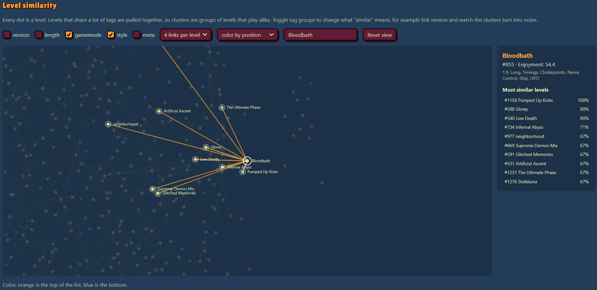
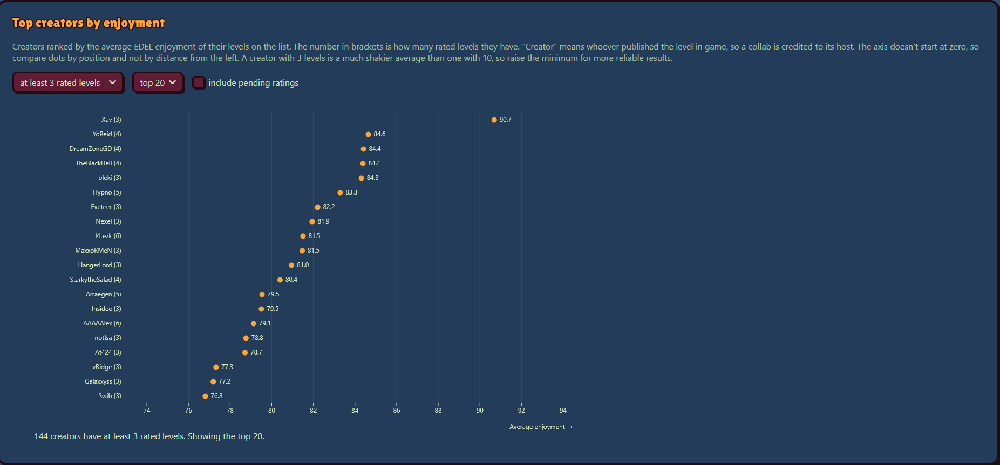
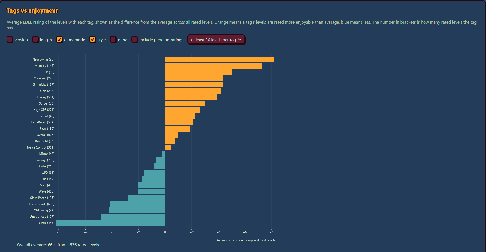
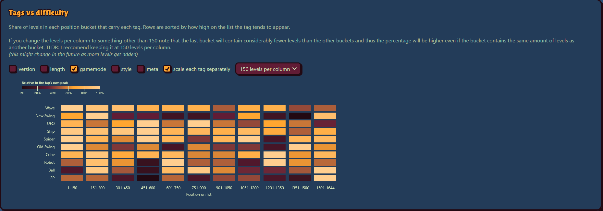

# GD Demonlist Visualization Tool

--> [**Live Project**](https://dada31735.github.io/gd-demonlist-visualization/) <--

---

A data visualization project exploring the [Observable Plot](https://observablehq.com/plot/) JavaScript library through Geometry Dash demonlist data.

I'm most familiar with the plotly + pandas stack for data analysis and visualization, but after seeing this used in another project, I thought it looked cool and decided to give it a try.

This project is primarily an opportunity for me to experiment with Observable Plot and an excuse to do some more data analysis because it's fun to make cool graphs.

## Some cool screenshots

Graph allowing you to see levels that are similar. For example, according to tag similarity, bloodbath is the most similar to Pumped up kicks as they both contain timings, ufo, ship, chokepoints and nerve controle (note here we only have gamemode and style checked so tags like 1.9 and Long dont affect the similarity score but you can always enable whatever you want)

Graph showing top extreme demon creators by their average level enjoyment rating. At the time of writing this, Xav is the top creator with an average enjoyment rating of 90.7 accross their 3 rated extremes.

Graph comparing tags vs enjoyment. Surprisingly (at least to me), levels containing new swing are on average the most enjoyed extreme demons. On the other hand, circles levels are the least enjoyed. Circles being low makes sense when you consider most of them have heinous chokepoints and really boring predrops.

Graph showing how often tags are present as you go up the list. To no one's surprise, wave heavy levels are more and more present as you go up the list. Circles levels are also noticeably more present as you go up on the list which might help explain why its the tag with the lowest average enjoyment. There's also an increase in unbalanced and timings based levels as we go up the list. Theres also a decrease in Long length levels as we go up and an increase in XL levels.

All data used for this project was gotten through the [AREDL](https://aredl.net/) public API. Go support them.
